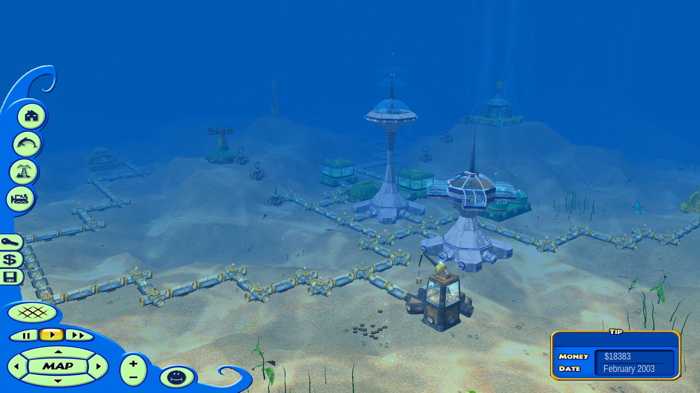

# DST NewWave

**An unofficial 64bit port of Deep Sea Tycoon (Atlantis Underwater Tycoon) for Windows 10/11 and
Linux.** DXVK rendering, bugfixes, optimization, enhanced terrain generation, and mod framework.

> **You need your own copy of the original game.** DST NewWave contains none of the game's files:
> it reads them from the copy you already own, and never changes that copy.

DST NewWave is a fan project. It is not made, endorsed or supported by the game's developers or
publishers. Deep Sea Tycoon and its content belong to their rights holders.

## Features

- **Runs on modern Windows.** A 64-bit build that draws through DXVK (Direct3D on Vulkan), and a
  32-bit build on Windows' own Direct3D 8 for PCs without Vulkan.
- **Native Linux build** as a single AppImage. Point it at your game folder (a Windows install,
  one made under Wine, or a copied folder).
- **Modern resolutions, widescreen and high refresh rates**, borderless window or exclusive full screen,
  field of view, vsync and frame cap, and a text size setting.
- **A full options window** in-game, with key rebinding, camera and zoom speed, edge scroll,
  sound and music volume, background mute, autosave and more.
- **Bugfixes**: crashes, save and load faults, a profile loader that could
  hang, a production-screen click that sold the wrong goods, 65 spelling mistakes in the game's
  texts ([full list](SPELLING_FIXES.md)), missing building sounds and more.
  Fixes that change the game's balance (for example biweekly loans, wave timing in some missions)
  are behind the **Game rules** option: *Original* by default, *Bug-fixed* if you want them.
- **A better sandbox**: maps up to 254 tiles, numerous terrain styles, custom seeds,
  animal and decor densities, texture palettes, and presets.
- **Visual polish**: backdrop pictures for every sandbox sea, terrain outside the map edge,
  optional slope shading, caustics and rock and silt on slopes.
- **Air tubes on slopes, ramps and stacked tubes**, up to two per tile with working connections.
- **Mod support.** A `mods` folder for file overrides (textures, models, sounds, music, texts, tables,
  missions, backdrops), plus mods that add new missions (the *Custom missions* screen)
  and new buildings (the *Mods* tab of the build panel), PNG textures with transparency and Ogg sounds.
  Saves remember which mods they used.
- **Crash reports** with a minidump on Windows, so bugs can be fixed.

The full list is in [CHANGELOG.md](CHANGELOG.md).

## System requirements

| | Windows, 64-bit build (recommended) | Windows, 32-bit build (fallback) | Linux |
|---|---|---|---|
| System | Windows 10 or 11, 64-bit | Windows 10 or 11 | x86-64 with glibc 2.35 or newer (Ubuntu 22.04, Debian 12, Fedora 36 and later) |
| Graphics | A card and driver with **Vulkan 1.3** (see below) | Any card with a Direct3D 8 driver | A recent Vulkan driver: Mesa newer than the one in Ubuntu 22.04 and Debian 12, or the GPU vendor's |
| The game | An installed copy of Deep Sea Tycoon or Atlantis Underwater Tycoon | same | The game's files, from a Windows install, Wine or a copied folder |

Cards that cannot run the 64-bit build, whatever driver you install: Nvidia GeForce 600 and 700
series (Kepler), and Intel HD/UHD graphics of 6th to 10th generation Core processors. The game
tells you so when it starts; install the 32-bit build instead.

## Installing

### Windows

1. Install the original game, if it is not installed already.
2. Download `DeepSeaTycoon-Setup-<version>.exe` from the [Releases](../../releases) page and run it.
   The installer is not code-signed, so Windows SmartScreen may warn you: choose
   *More info*, then *Run anyway*. You can check the download against the SHA-256 hash on the
   release page first.
3. The installer finds your copy of the game (or asks where it is), copies its data into the new
   install folder, and converts the music track. Your original installation is only read.

Silent install: `DeepSeaTycoon-Setup-<version>.exe /S [/BITS=32] [/SRC=<game folder>] [/D=<install folder>]`.

### Linux

1. Download `Deep_Sea_Tycoon-<version>-x86_64.AppImage` and make it executable
   (`chmod +x Deep_Sea_Tycoon-*.AppImage`).
2. Start it. On the first start it asks for the game folder (the one with `MENU.TXT` and
   `menu_graphics`, in any letter case). You can also give it as the first argument or in
   `DST_GAME_DIR`.

The game folder can be read-only; nothing is written there.

## Where things are

| | Windows | Linux |
|---|---|---|
| Settings (`settings.ini`, every option with a comment) | `Saved Games\Deep Sea Tycoon\` | `~/.local/share/deep-sea-tycoon/` |
| Saves and profiles | `...\save_game\` (saves in the original game folder are still found) | `.../save_game/` |
| Logs | `...\logs\` | `.../logs/` |
| Crash reports | `...\crashes\` | (no crash handler yet) |
| Mods | `...\mods\<mod name>\` | `.../mods/<mod name>/` |

Delete `settings.ini` to go back to the defaults. The options window is under *Change video
options* on the main menu, or Escape during a game.

## Mods

Put each mod in its own folder under `mods\`. Without a `mods\load_order.txt` every mod folder is on;
with one, only the folders it lists are on, and the top one wins. A mod's files replace
the game's files of the same path and name when the game reads them; the game's own files are never
changed. `logs\launch.log` lists the mods and every file they replaced.

The **modding kit**, `DeepSeaTycoon-Modding-<version>.zip` on the release page, has the guide (file
formats, the mission script reference, name mappings), templates, a sample mod with two custom
missions and a new building, the backdrop framing guides, and the list of the game's files.

**Backdrops.** The pictures on the horizon come with the game, in the install folder's `backdrops`
folder (Linux: inside the AppImage). To use your own, put a `backdrops\backdrops.txt` and its
pictures in your user folder or in a mod, as the guide's section 11 describes; that list replaces
the included one.

## Known issues

See [KNOWN_ISSUES.md](KNOWN_ISSUES.md). Only tested on one PC (Windows 11, AMD graphics).
Nvidia and Intel cards, Windows 10 and Linux are expected to work but are untested.

## Reporting a bug

Open an [issue](../../issues) and attach:

- `logs\launch.log` and `logs\exit.log` from the folder above,
- for a crash, the newest `.txt` and `.dmp` from `crashes\`,
- your graphics card, driver version and which build (64-bit, 32-bit or Linux) you used.

## Source

This repository holds the releases, this documentation, the license notices and source of
the libraries the port includes, and the patches applied to DXVK. If you are working on
something related and need more technical detail, open an issue or send a message.

## Disclaimer and licenses

DST NewWave is provided as is, without warranty of any kind, express or implied. You use it at
your own risk; the authors are not liable for any damage or loss arising from its use, including
to your saves or your installation of the original game.

Deep Sea Tycoon (Atlantis Underwater Tycoon) and its content, names and logos are the property
of their respective owners and are used here only to identify the game this port runs. This
project is not affiliated with or endorsed by them. All other trademarks belong to their owners.

It includes these libraries, each under its own licence; the texts are installed with the game
and listed in [THIRD_PARTY_NOTICES.md](THIRD_PARTY_NOTICES.md):
SDL 3 (zlib), DXVK (zlib), OpenAL Soft (LGPL 2), FFmpeg on Linux only (LGPL 2.1), libogg and
libvorbis in the Windows installer's music converter (BSD), stb_vorbis and stb_truetype (MIT or
public domain), and the Liberation Sans font (SIL Open Font Licence).
